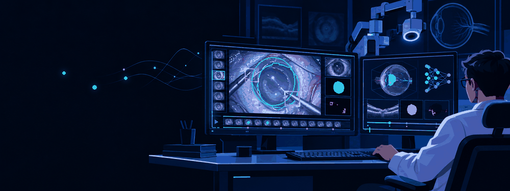
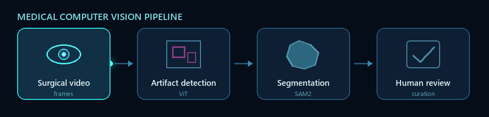
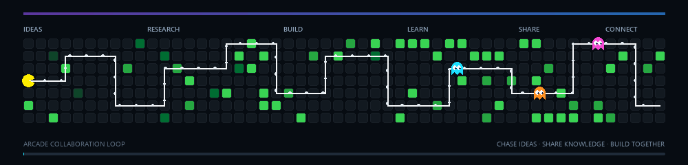

  

<h1 align="center">Hello, dear visitors 👋</h1>

  <strong>Computer Vision for Healthcare · Surgical Data Science · Deep Learning</strong>

  
  
  

I am a Computer Science master's student at **TU Darmstadt** and a working student at **Fraunhofer IGD**. I build computer vision systems for surgical video understanding and medical image analysis, with a focus on reliable evaluation and tools that keep humans in the review loop.

## 👁️ What I build

  

- **Surgical video understanding:** detecting visual artifacts and segmenting surgical scenes.
- **Medical image segmentation:** studying U-Net and foundation-model workflows for ophthalmic and histopathology images.
- **Review and curation tools:** turning frame-level predictions into timelines, editable annotations, and reproducible analysis.

## 🚀 Featured computer vision work

### [Surgical Artifact Detection](./projects/surgical-artifact-detection.md)

Built a surgical video analysis pipeline using **SegSTRONG-C** and **Cholec80**, with a ViT-based classifier for smoke, blood, low brightness, blur, and lens contamination. Implemented frame-level inference, CSV export, timeline visualization, and an interactive GUI for reviewing and correcting predictions.

→ [Read the project overview](./projects/surgical-artifact-detection.md)

### [Surgical Video Segmentation with SAM2 & SASVi](https://github.com/Stevenyami/Bachelor_Poster)

Fine-tuned SAM2 on **CaDIS** and studied its integration into **SASVi** for surgical scene segmentation. The work evaluates spatial segmentation quality and temporal consistency, with qualitative transfer to **OphNet**.

Nominated for the **Freudenberg Award Digital Science 2026**, among the top three bachelor's theses at TU Darmstadt.

→ [Read the thesis poster](https://github.com/Stevenyami/Bachelor_Poster/blob/main/Bachelor_Poster.pdf)

### [Nuclei Segmentation in Histopathology](https://github.com/Stevenyami/Pre_task_Bachelor_Thesis)

Investigated U-Net segmentation and exploratory cell counting in microscopy images, including data splits, patch-based training, and edge effects. The public notebook implements annotation processing, training, and prediction visualization in **TensorFlow/Keras**.

→ [Explore the notebook](https://github.com/Stevenyami/Pre_task_Bachelor_Thesis/blob/main/Pretask_for_Bachelor_Thesis.ipynb)

## 🛠️ Tools I use

  
  
  
  
  
  
  
  

  
<strong>Related healthcare work</strong>

   

- **SiLA2 laboratory integration:** developed a Python server interface for a serial CPR Cycler device, including control commands, error handling, debugging, and command simulation.
- **[Virtual Cohorts for Medical Analytics](https://github.com/Stevenyami/Seminar-Paper-Virtual-Cohorts-for-Medical-Analytics):** literature review of synthetic patient data, including Synthea, GANs, and SDV.

## 🤝 Let's connect

  

I am interested in exchanging ideas and collaborating on **computer vision for healthcare**, **medical image analysis**, and **surgical data science**.

  <a href="https://www.linkedin.com/in/steve-nyami/">LinkedIn</a> ·
  <a href="https://steve-nyami.vercel.app/">Portfolio</a> ·
  <a href="mailto:stevenyami315@gmail.com">Email</a>

Visual artwork generated with OpenAI ImageGen and animated specifically for this profile.
