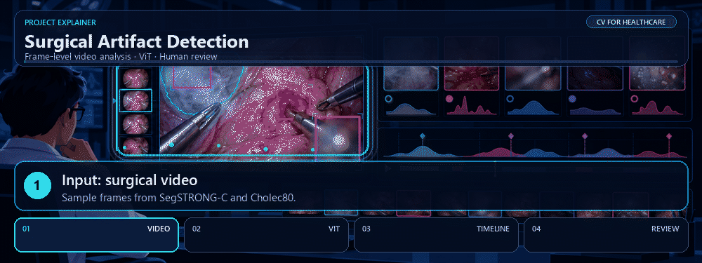
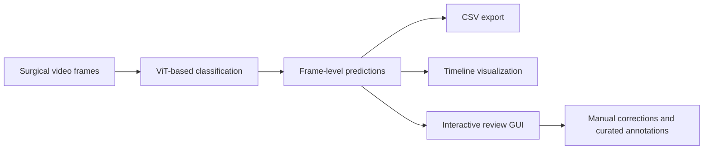

# Surgical Artifact Detection

**Computer Vision for Healthcare · Surgical Data Science · Vision Transformers**

Project overview of my **Visual Computing Internship at Fraunhofer IGD**, April–September 2026.

  

## Project focus

Detect and review visual artifacts in laparoscopic surgical videos, including **smoke, blood, low brightness, blur, and lens contamination**.

The work connects model predictions with tools for inspecting videos and curating annotations.

## My contribution

- Built an end-to-end surgical video analysis pipeline using **SegSTRONG-C** and **Cholec80**.
- Trained a **Vision Transformer (ViT)-based classifier** to identify surgical video corruptions.
- Implemented **frame-level inference** and **CSV export** of predictions.
- Developed **timeline visualizations** and an **interactive GUI** for manual review and correction.
- Prepared **multi-label video annotations** to support data curation and future fine-tuning on Cholec80.

## Workflow overview

This diagram summarizes the main components; it is not a specification of the implementation.

## Project outputs

| Component | Purpose |
| --- | --- |
| Artifact classifier | Identify visual corruptions in surgical video frames |
| Inference and CSV export | Make frame-level predictions available for inspection and analysis |
| Timeline visualization | Inspect predictions across a video |
| Interactive GUI | Review and correct model predictions |
| Multi-label annotations | Support dataset curation and subsequent model development |

## Connection to my other work

This project complements my [SAM2/SASVi surgical video segmentation thesis](https://github.com/Stevenyami/Bachelor_Poster) and [U-Net histopathology project](https://github.com/Stevenyami/Pre_task_Bachelor_Thesis): together they cover surgical video quality, scene segmentation, and medical image analysis.

[Back to my profile](../README.md)
